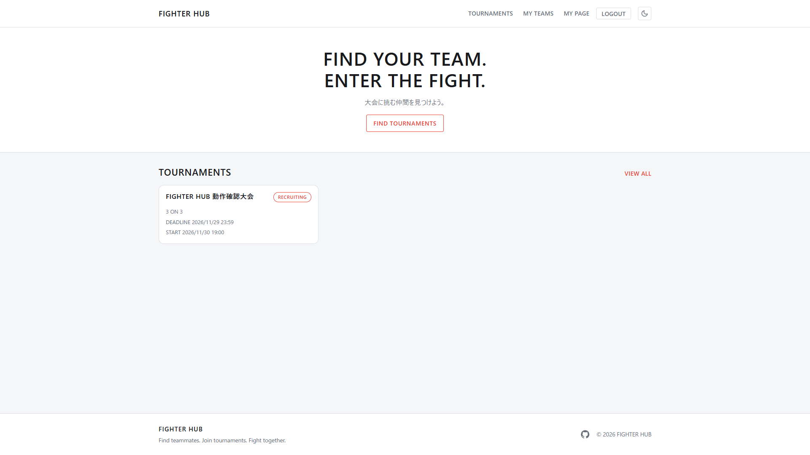
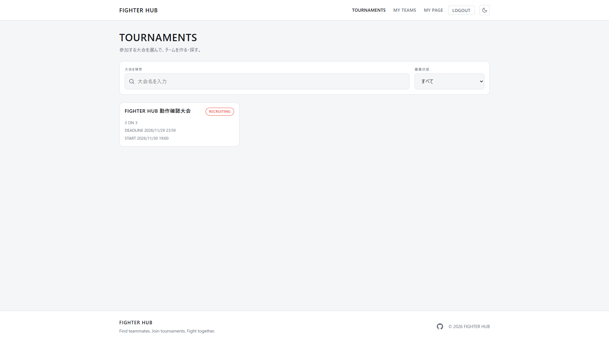
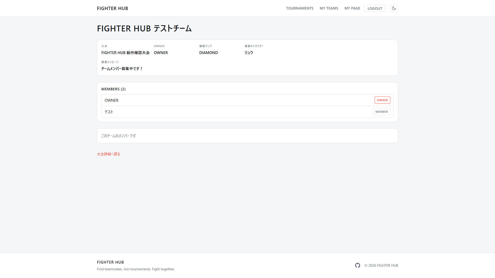
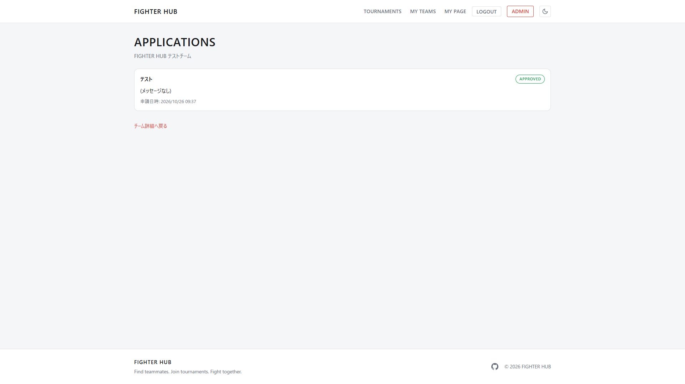
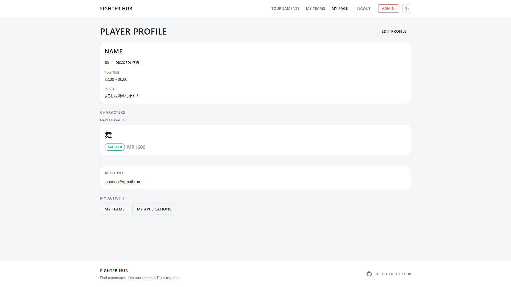
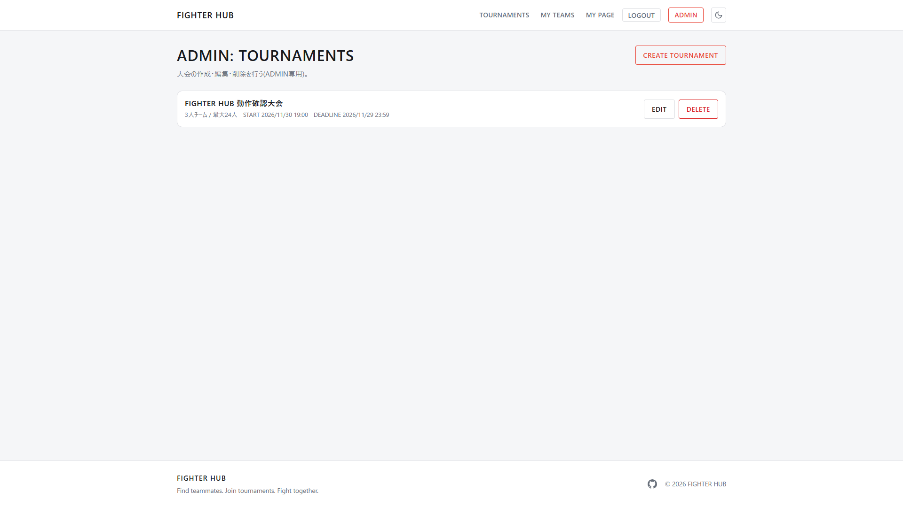

# FIGHTER HUB

FIGHTER HUBは、格闘ゲームのチーム戦大会に向けたチーム結成・メンバー募集を支援するWebアプリケーションです。

## Overview

格闘ゲームの3on3や5on5などのチーム戦大会では、
「大会に参加したいが一緒に出場するメンバーが見つからない」
「チームを作ったが、あと1人メンバーを募集したい」
といったケースがあります。

FIGHTER HUBでは、大会ごとにチームを作成してメンバーを募集したり、
参加したいチームを探して応募したりできる仕組みを提供することで、
チーム戦大会に参加するプレイヤー同士のマッチングを支援します。

## 公開サイト(本番環境)

**https://fighter-hub.duckdns.org/**

> AWS Lightsail上の個人運用環境のため、常時稼働を保証するものではありません。

## Screenshots

### TOPページ



TOPページ。大会に参加するチームメイトを見つけるための導線を表示します。

### 大会・チーム・プロフィール

<table>
<tr>
<td width="50%">

<br>大会一覧。大会名での検索・募集状態での絞り込みができます。
</td>
<td width="50%">

<br>チーム詳細。募集ランク・募集キャラクター・メンバー一覧を表示します。
</td>
</tr>
<tr>
<td width="50%">

<br>チームへの参加申請一覧(Team owner向け)。各申請の承認状況を確認できます。
</td>
<td width="50%">

<br>マイページ。プロフィール・使用キャラクター・Discordアカウント連携状況を表示します。
</td>
</tr>
<tr>
<td width="50%">

<br>ADMIN専用の大会管理画面。大会情報の登録・編集・削除を行います。
</td>
<td width="50%"></td>
</tr>
</table>

## 主な機能

### 大会・チーム

- 大会一覧・詳細の取得、大会ごとの募集中チーム一覧の取得・検索
- チームの作成(作成者が自動的にownerかつメンバーになる)・編集(ownerのみ)・一覧・詳細取得
- 同一大会内では1ユーザーにつき1チームのみ所属可能(重複所属防止)
- チームメンバー一覧取得・メンバー削除(ownerのみ、owner自身は削除不可)
- 募集締切日時(recruitmentDeadline)の設定と、締切後の新規チーム作成・新規応募の禁止
- 募集状態(募集中/募集終了)はDBに保存せず、締切日時と現在時刻から都度判定

### 参加申請・承認

- チームへの参加申請、Team ownerによる参加申請一覧の取得・承認・拒否
- 承認時のチームメンバー自動追加(承認とメンバー追加を同一トランザクションで実施)
- チーム定員を超える承認の防止、同一大会内で同時に保持できるPENDING申請は1ユーザー1件まで
- 複数の承認・申請が同時に発生した場合の整合性を、悲観的ロックで保証(詳細は[設計・技術的工夫](#設計技術的工夫)参照)

### プロフィール・Discordアカウント連携

- ユーザー登録・ログイン(JWT発行)、公開プロフィール・自分のプロフィールの取得・更新
- 使用キャラクター・ランク・MR(Master Rate)・プレイ時間・自己紹介メッセージの登録
- Discordアカウント連携(OAuth 2.0 Authorization Code Flow)・連携解除。連携済みの場合はDiscordの表示用ユーザー名を公開プロフィールに表示
- ソフトデリート済みユーザーは認証・各種取得APIの対象外

### ADMIN(大会管理)

- ユーザーのroleベースの認可(DB上の`User.role`がADMINのユーザーのみ)
- ADMIN専用の大会情報(名称・日時・募集締切・チーム定員等)の登録・編集・削除(Frontendには`/admin/tournaments`配下に専用画面)。大会の進行管理・対戦管理・勝敗管理は提供しません
- 大会を論理削除すると、配下のチーム・メンバー・参加申請は(データ自体は削除されず)取得・操作の対象外になる

## 技術スタック

### Backend

- Java 21 / Spring Boot 4.0.8
- Spring Web MVC / Spring Data JPA / Spring Security(OAuth2 Resource Server, JWT Bearer認証)
- Flyway(DBマイグレーション。`V1__initial_schema.sql`でスキーマ、`V2__seed_characters.sql`でマスタデータを管理。Hibernateの`ddl-auto`は`validate`のみ)
- Jakarta Validation / jackson-databind-nullable(PATCHの部分更新で「未指定」と「明示的null」を区別)
- springdoc-openapi(Swagger UI / OpenAPI自動生成)

### Frontend

- Vue 3(^3.5) / TypeScript(~6.0) / Vite(^8.2)
- Vue Router(^5.3) / Pinia(^4.0) / Axios(^1.20)
- Vitest(^4.1、単体テスト)

### Database

- PostgreSQL 18

### Infrastructure(本番環境)

- AWS Lightsail(Ubuntu)
- Docker / Docker Compose
- Caddy(HTTPS終端・Let's Encrypt自動証明書・セキュリティヘッダー)
- Nginx(Frontend静的ファイル配信・`/api`リバースプロキシ)

詳細な構成図は [docs/architecture.md](docs/architecture.md) を参照してください。

### Development / Testing

- Maven(Maven Wrapper) / JUnit 5 / Mockito / MockMvc
- Git / GitHub

## API Documentation

API仕様はJava実装(Controller / DTO / Validation等)をSource of Truthとします。実装済みAPIの仕様は、Springdoc OpenAPIによってControllerやDTOの定義から生成しています。

### 実装済みAPI

| Method | Path | 認証 |
|---|---|---|
| GET | /api/characters | 不要 |
| GET | /api/characters/{id} | 不要 |
| POST | /api/users | 不要 |
| GET | /api/users/{id} | 不要 |
| POST | /api/auth/login | 不要 |
| GET | /api/users/me | JWT必須 |
| PATCH | /api/users/me | JWT必須 |
| DELETE | /api/users/me/discord | JWT必須 |
| POST | /api/oauth/discord/authorize | JWT必須 |
| GET | /api/oauth/discord/callback | 不要(Discordからのcallback) |
| POST | /api/teams | JWT必須 |
| GET | /api/teams | 不要 |
| GET | /api/teams/{id} | 不要 |
| GET | /api/teams/my | JWT必須 |
| PATCH | /api/teams/{id} | JWT必須 |
| GET | /api/teams/{id}/members | 不要 |
| DELETE | /api/teams/{teamId}/members/{userId} | JWT必須 |
| POST | /api/teams/{teamId}/applications | JWT必須 |
| GET | /api/teams/{teamId}/applications | JWT必須(Team owner) |
| GET | /api/applications/me | JWT必須 |
| PATCH | /api/teams/{teamId}/applications/{applicationId}/approve | JWT必須(Team owner) |
| PATCH | /api/teams/{teamId}/applications/{applicationId}/reject | JWT必須(Team owner) |
| GET | /api/tournaments | 不要 |
| GET | /api/tournaments/{id} | 不要 |
| POST | /api/tournaments | JWT必須(ADMIN) |
| PATCH | /api/tournaments/{id} | JWT必須(ADMIN) |
| DELETE | /api/tournaments/{id} | JWT必須(ADMIN) |
| GET | /api/tournaments/{tournamentId}/teams | 不要 |

ローカル起動後、以下からも仕様を確認できます。

- Swagger UI: `http://localhost:8080/swagger-ui/index.html`
- OpenAPI JSON: `http://localhost:8080/v3/api-docs`

`docs/openapi.yaml` は、実装済みAPIを記録するリポジトリ内のAPI仕様書です。未実装・将来予定のAPIは記載せず、API実装・変更が完了するたびにJava実装へ同期します。

## アーキテクチャ

### Backend

Controller・Service・Repositoryの各レイヤーに責務を分離しています。

```text
Client
  ↓
Controller
  ↓
Service
  ↓
Repository
  ↓
PostgreSQL
```

- **Controller**: HTTPリクエストの受付とレスポンスの返却
- **Service**: ビジネスロジックとトランザクション管理
- **Repository**: Spring Data JPAを利用したデータアクセス
- **Entity**: データベースのテーブル構造をJavaオブジェクトとして表現
- **DTO**: APIの入出力モデルとしてEntityとAPIを分離
- **GlobalExceptionHandler**: APIで発生した例外を共通のエラーレスポンスへ変換

### Frontend

`frontend/`配下はVue 3 + TypeScriptで構成しています。

- **views**: 画面単位のVueコンポーネント。APIの呼び出しと画面表示を行う
- **router**: Vue Routerによるルーティング定義。`meta.requiresAuth`で認証必須ページ、`meta.requiresAdmin`でADMIN専用ページ(`/admin/tournaments`配下)を制御する
- **stores**: Piniaによる状態管理。現状は認証状態を扱う`auth` storeのみ
- **api**: Axiosを使ったバックエンドAPI呼び出し層。エンドポイントごとに薄い関数として実装している
- **types**: バックエンドの各DTOに対応するTypeScript型定義

### 本番環境(AWS)

AWS Lightsail(単一インスタンス)上でDocker Composeにより、Caddy・Nginx・Spring Boot・PostgreSQLの4コンテナを稼働させています。外部に公開するポートはCaddyの80/443番のみで、他のコンテナはDocker Composeの内部networkからのみ到達できます。

詳細な構成図・通信経路は [docs/architecture.md](docs/architecture.md) を参照してください。

## 認証・認可

BackendはJWT Bearer認証(Spring Security OAuth2 Resource Server, Stateless)でAPIを保護しています。ADMIN専用APIは、DB上の`User.role`を基準にService層で認可判定を行います(ロール変更・昇格を行うAPIは提供していません)。

Frontendでは以下の仕組みで認証状態を扱います。

- JWTをlocalStorageに保存
- Axios interceptor(`api/client.ts`)でリクエストへ`Authorization: Bearer <token>`を自動付与
- Pinia auth store(`stores/auth.ts`)で認証状態(token・ログインユーザー情報・role)を管理
- Vue Routerの`meta.requiresAuth`/`meta.requiresAdmin`で保護ページへのアクセスを制御(未認証は`/login`へ、認証済みだがADMINではない場合は`/forbidden`へ遷移)

## 設計・技術的工夫

- **参加申請承認の悲観的ロック・デッドロック回避**: `RecruitmentApplicationService#approveApplication`では、承認対象の申請と「同一ユーザーの同一大会内の他PENDING申請」を1クエリでID昇順にまとめてPESSIMISTIC_WRITEロックします。対象→他件を別々にロックする2段階の実装では異なるTeam ownerがほぼ同時に承認した際にデッドロックが発生し得るため、1クエリ・一定順序のロック取得に統一して構造的に回避しています。実PostgreSQLを使った並行実行の統合テストでも整合性を確認しています。
- **role認可**: ADMIN判定はController層ではなくService層(`TournamentService#validateAdmin`)で一元管理し、認可漏れを防いでいます。ADMINへの昇格を行うAPIは提供していません(運用上の意図的な設計)。
- **論理削除の一貫設計**: 全テーブルで`delete_flag`による論理削除を採用し、Team/TeamMemberの「有効」判定は常にTournament・Userのdelete_flagも合わせて確認します。そのため大会を論理削除すると、配下のチーム関連APIは連鎖的に対象外(404)になります(物理削除やカスケード処理は行わず、クエリ条件の設計のみで実現)。
- **Discord OAuthのstate設計**: Spring SessionやDBのstateテーブルを使わず、HMAC-SHA256で署名した短命(5分)のstateトークンを自前実装しています。署名比較は`MessageDigest.isEqual`による定数時間比較を用い、タイミング攻撃を避けています。
- **ログインのレート制限・タイミング差対策**: IP単位・(IP+メールアドレス)単位の2種類の固定ウィンドウでログイン失敗を制限します(メールアドレス単独でのロックは行わず、第三者が他人のメールアドレスだけでアカウントを締め出せないようにしています)。また、メール不存在・未設定パスワードの場合もダミーハッシュで必ず1回パスワード照合を行うことで、応答時間からメールアドレスの存在有無を推測しにくくしています。
- **HTTPS・セキュリティヘッダー**: Caddyで自動HTTPS化し、HSTS・Content-Security-Policy等のセキュリティヘッダーを付与しています。CSPは実際のフロントエンド実装(外部ドメインへのリクエストが無いこと)を調査した上で、`default-src 'self'`中心の方針にしています。

## テスト・品質

- **Backend**: 556件(JUnit 5 / Mockito / MockMvc)。Service層・Controller層の単体テストに加え、実PostgreSQLを使った統合テスト(認可・ソフトデリート・並行実行時の排他制御・HTTP経由の複数リクエストをまたぐ業務フロー検証等)を含みます。
- **Frontend**: 298件(Vitest / @vue/test-utils)。

上記の自動テストに加え、本番環境(AWS Lightsail)上で以下の手動検証を実施済みです(自動テストではなく、都度人が操作して確認したものです)。

- 大会作成 → チーム作成 → 参加申請 → 承認までの一連の操作
- Discordアカウント連携・連携解除
- PostgreSQLのバックアップ取得・復元(リストアできることの確認)

これらは一度限りの手動確認であり、定期的なバックアップ取得・復元を自動化する運用(自動バックアップ運用)は別途未導入です。CI(継続的インテグレーション)も未導入です。

## セットアップ

Docker Composeでアプリ全体を起動する場合、ホスト側に必要なのは基本的に以下の2つだけです。

- Git
- Docker Desktop(Docker Composeを含む)

Backend / Frontendをホスト上で個別に起動して開発する場合は、上記に加えて以下が追加で必要です。

- Java 21(Maven自体のインストールは不要です。Maven WrapperがBackendのbuild/起動に必要なMavenを自動で取得します)
- Node.js(`frontend/package.json` の `engines.node` に記載のバージョンを参照してください)
- PostgreSQL 18(Docker版PostgreSQLはhostへportを公開していないため、個別起動時は別途ローカルに用意してください)

以下はFIGHTER HUB全体(Frontend / Backend / PostgreSQL)をローカルのDocker Composeでまとめて起動する手順です(`compose.yaml`、本番用の`compose.prod.yaml`とは別物です)。Backend / Frontendを個別にホスト上で起動する従来の開発方法も引き続き利用できます。

### 1. Clone repository

```bash
git clone https://github.com/krbn96/fighter-hub.git
cd fighter-hub
```

### 2. Configure environment variables

```bash
cp .env.example .env
```

`.env` を編集し、以下を設定してください(`.env` はGit管理対象外です。実値をREADMEやGit管理対象のファイルへ直接記載しないでください)。

- `DB_PASSWORD`: PostgreSQLの接続パスワード(任意の文字列)
- `JWT_SECRET`: JWT署名用secret。Base64エンコードされた32byte(256bit)以上の値が必要です(生成例: `openssl rand -base64 32`)

> DB_PASSWORDには任意のパスワードを設定できます。初回起動時にPostgreSQLの認証情報として使用されます。PostgreSQLのデータを保存するDocker volume作成後に値を変更すると、既存DBへ接続できなくなる場合があるため注意してください。

### 3. Start with Docker Compose(推奨)

```bash
docker compose up --build
```

起動後、ブラウザから `http://localhost` へアクセスしてください。Frontend(Nginx)が `/api` 宛のリクエストを同一オリジンでBackendへreverse proxyするため、CORS設定は不要です。

> すでに別のWebサーバー等がport 80を使用している場合、上記コマンドが `port is already allocated` のようなエラーで失敗することがあります。この場合は `compose.yaml` の `frontend.ports` を `"8080:80"` のように別のhost側portへ変更してください(アクセスURLは `http://localhost:8080` になります)。

### 4. Stop

```bash
docker compose down
```

で停止できます。`-v` オプション(`docker compose down -v`)を付けるとPostgreSQLのデータを保存しているnamed volumeも削除され、保存済みデータがすべて消えてしまうため、通常は付けないでください。

### ローカル開発時の個別起動(Docker無し)

Backend / Frontendをホスト上で個別に起動して開発する場合は、環境変数(`DB_PASSWORD` / `JWT_SECRET`)を設定した上で以下を実行します。Docker版PostgreSQLはhostへportを公開していないため、この方法を使う場合は別途ローカルにPostgreSQLを用意してください。

Backend:

```bash
./mvnw spring-boot:run
```

Windows PowerShellの場合は `.\mvnw spring-boot:run` を使用してください。`http://localhost:8080` で起動します。

Frontend:

```bash
cd frontend
npm install
npm run dev
```

開発時は、Vite dev serverの設定(`frontend/vite.config.ts`)により `/api` 宛のリクエストをSpring Boot(`http://localhost:8080`)へproxyします。

### Backendテストの実行

```bash
./mvnw test
```

Windows: `.\mvnw test`。クリーンビルドから実行する場合は `./mvnw clean test`(Windows: `.\mvnw clean test`)。

### Frontendテスト・品質チェックの実行

`frontend`ディレクトリで以下を実行します。

```bash
npm run type-check
npm run lint
npm run test:unit -- --run
```

## 今後の改善予定

現時点で未実装・未導入の項目です(実装済み機能と混同しないよう明記します)。

- CI/CD(GitHub Actions等によるテスト自動実行・自動デプロイ)の導入
- 本番環境の自動監視・アラート通知の導入
- データベースの自動バックアップ運用(現状は手動でのバックアップ取得・復元確認を実施済みですが、定期実行の自動化は未導入です)
- メールアドレスの確認(verification)メール送信機能(現在のユーザー登録はメール確認を行いません)
- 本番環境相当でのエンドツーエンドの結合テスト・負荷テストの実施
