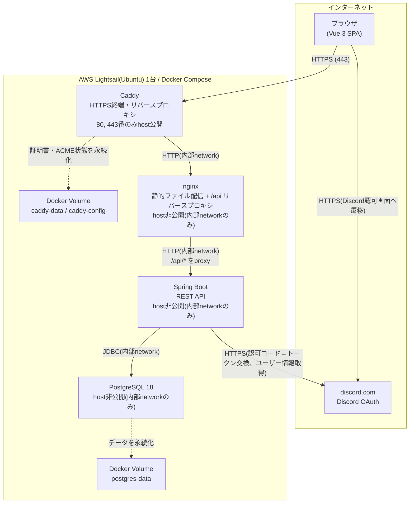

# AWS構成図

FIGHTER HUBの本番環境(AWS Lightsail)の構成図です。実際の`compose.prod.yaml`・`Caddyfile`の設定内容をそのまま反映しています。RDS・ALB・CloudFront・S3等、実際には使用していないAWSサービスは記載していません(単一のLightsailインスタンス上でDocker Composeにより全コンポーネントを稼働させる構成です)。

## 通信経路の説明

1. **ブラウザ → Caddy(HTTPS, 443番)**: 外部に公開されているのはCaddyの80/443番のみです。80番へのアクセスはCaddyが自動でHTTPSへリダイレクトします。CaddyはLet's Encryptから証明書を自動取得・更新します(ドメイン: `fighter-hub.duckdns.org`)。
2. **Caddy → nginx(HTTP, 内部network)**: CaddyはTLSを終端した後、Docker Composeの内部networkを経由して平文のHTTPでnginxへ転送します。nginx自体はhostへポートを公開していないため、Caddyを経由しない直接アクセスはできません。
3. **nginx → Spring Boot(HTTP, 内部network)**: nginxはビルド済みのVue静的ファイルをそのまま配信し、`/api/*`宛のリクエストのみSpring Bootへリバースプロキシします。Spring Bootもhostへポートを公開していません。
4. **Spring Boot → PostgreSQL(JDBC, 内部network)**: Spring BootはJDBCでPostgreSQLへ接続します。PostgreSQLもhost非公開で、内部networkからのみ到達できます。
5. **ブラウザ → discord.com(HTTPS)**: Discordアカウント連携時、ブラウザは認可URLへ画面遷移します(フロントエンドからのfetch/XHRではなく、ページ遷移そのものが外部ドメインへ向かう形です)。
6. **Spring Boot → discord.com(HTTPS)**: callback受信後、Spring Bootがサーバー側でDiscordへ認可コード→アクセストークンの交換、ユーザー情報の取得を行います。

## 永続化

- **PostgreSQL**: `postgres-data`という名前付きDocker Volumeにデータを永続化します。コンテナを再作成してもデータは保持されます。
- **Caddy**: 証明書・ACME(Let's Encrypt)の状態を`caddy-data`・`caddy-config`という名前付きDocker Volumeに永続化します。これにより、コンテナ再作成時の証明書再取得を避けられます。

## 備考

- 本図は調査に基づく現状の構成であり、将来的な構成変更(マネージドDBへの移行等)は含みません。
- secret(DB接続パスワード、JWT署名鍵、Discordアカウント連携用の認証情報等)は`.env.prod`ファイルからコンテナへ注入しており、本図・リポジトリのいずれにも実値は含まれません。
